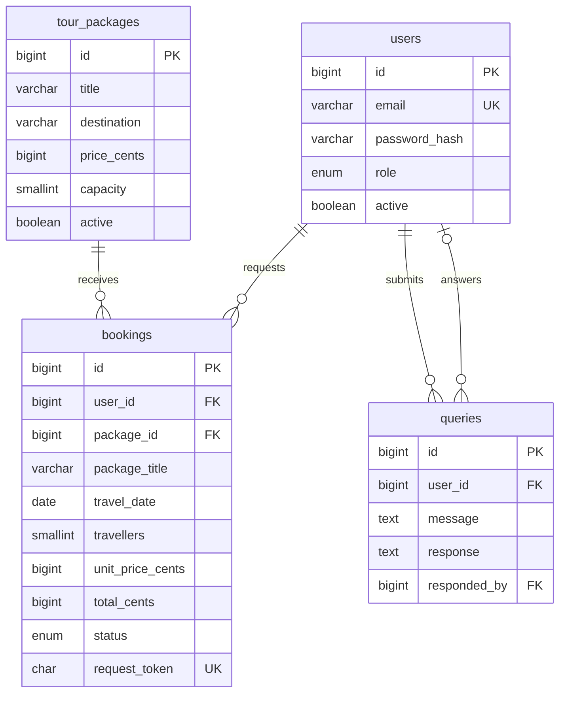

# Architecture and requirements

The application uses server-rendered PHP pages, a shared PDO connection and MySQL/InnoDB. The public document root contains only web endpoints and assets. Secrets and CLI utilities remain outside it. PHP sessions identify users; roles and active status are reloaded for every request.

| Report requirement | Implementation |
| --- | --- |
| FR01: registration and login | `public/register.php`, `public/login.php`, `public/logout.php`, shared authentication helpers |
| FR02: browsing and search | `public/index.php`, `public/packages.php`, `public/package-details.php` |
| FR03: tour bookings | Transactional booking service, customer dashboard, date/capacity validation, cancellation |
| FR04: package management | Staff create/edit/archive/restore/delete screens; deletion protects booking history |
| FR05: customer queries | Authenticated contact form, private conversation history, staff response screen |
| FR06: administrator reports | Travel-date filters, totals by package title, safe CSV export |
| Staff and administrator roles | Server-side role checks; customer registration cannot choose a privileged role |
| User administration | Role changes and deactivation, with self-lockout protection |
| Responsive navy/orange UI | Bootstrap 5.3 grid/components and custom CSS, semantic forms and navigation |

## Data model

`login_attempts` stores a hash of email plus source IP and a 15-minute failure window. It contains no plaintext password. The schema retains business records using restricted foreign-key deletes, instead of cascading away booking history when an account or tour is removed. Enquiry responder references become null if a responder is deleted outside the application.

## Booking transaction

1. Validate date, guest count, CSRF token and customer role.
2. Begin a transaction and lock the selected package row.
3. Reject inactive packages and detect an existing idempotency token.
4. Sum spaces reserved for that package and departure date.
5. Reject requests exceeding capacity.
6. Copy the database price/title into the booking, calculate the total and insert a pending request.
7. Commit and redirect to the customer's history.

Package capacity edits use the same package lock and cannot reduce capacity below existing future reservations. Bookings are never priced using a hidden browser field. All status updates enforce an allowlist of valid transitions.

## Scope and assumptions

Each package has one departure per selected date, available throughout the two-year booking window. Real blackout dates, departure times, guide availability and season-specific pricing would require a separate departures model. Capacity applies per departure, not across overlapping days of multi-day itineraries. Sample copy, prices and images must be replaced before commercial use.

The report serves as product requirements and design context. Its claims about past testing, mathematical immunity to attacks or real customer feedback are not inherited as verified claims. The implementation adds CSRF protection, database-backed throttling and safe history retention while maintaining the requested functional scope.
